# Captures d'écran des tests d'API (Bruno et Terminal)

Ce document présente les captures d'écran des tests réalisés sur l'API Spring Boot pour les **Exercices 1, 2 et 4**.

---

## Exercice 1 — Hello World REST

### 1.1 — GET /api/v1/bonjour (Message d'accueil général)

> **Description :** Requête simple pour récupérer le message par défaut.  
> **Résultat :** Code `200 OK` avec `{"message": "Bonjour le monde !"}`.

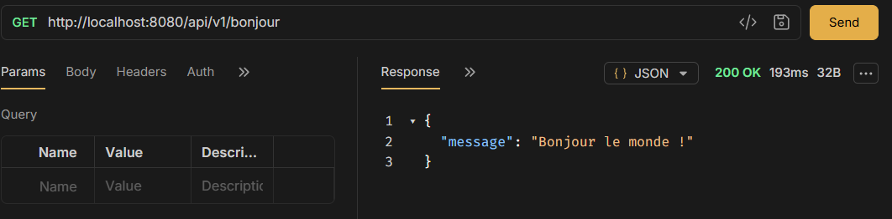

---

### 1.2 — GET /api/v1/bonjour/{prenom} (Message personnalisé)

> **Description :** Extraction de la variable d'URL `@PathVariable` pour personnaliser le message.  
> **Résultat :** Code `200 OK` avec `{"message": "Bonjour Marie !"}`.

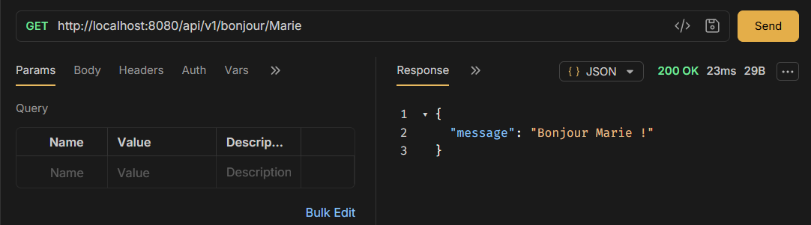

---

### 1.3 — POST /api/v1/bonjour (Bienvenue avec prénom en JSON)

> **Description :** Envoi d'un corps JSON contenant `{"prenom": "Jean"}`.  
> **Résultat :** Code `200 OK`.

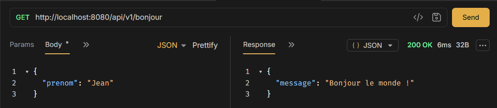

---

## Exercice 2 — CRUD Utilisateurs

### 2.1 — GET /api/v1/utilisateurs (Lister tous les utilisateurs)

> **Description :** Récupération de tous les utilisateurs initialisés en mémoire via `data.sql`.  
> **Résultat :** Code `200 OK` avec le tableau JSON complet des utilisateurs.

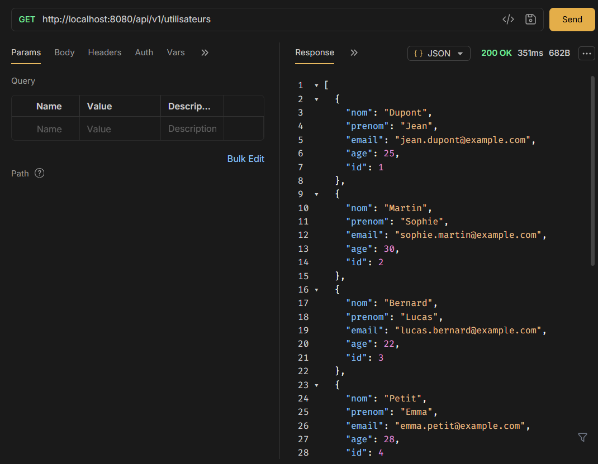

---

### 2.2 — GET /api/v1/utilisateurs/1 (Obtenir un utilisateur par son ID)

> **Description :** Récupération d'un utilisateur spécifique à partir de son identifiant (`id = 1`).  
> **Résultat :** Code `200 OK` avec les informations de Jean Dupont.

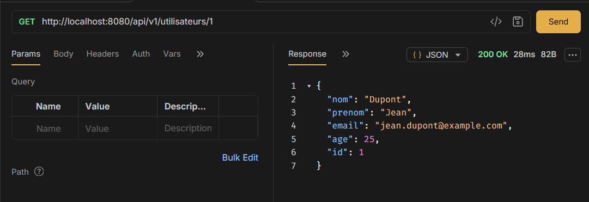

---

### 2.3 — POST /api/v1/utilisateurs (Créer un utilisateur)

> **Description :** Création d'un nouvel utilisateur (Claire Lemoine) avec validation des champs.  
> **Résultat :** Code `201 Created` avec l'utilisateur enregistré et son `id` auto-généré (`id = 9`).

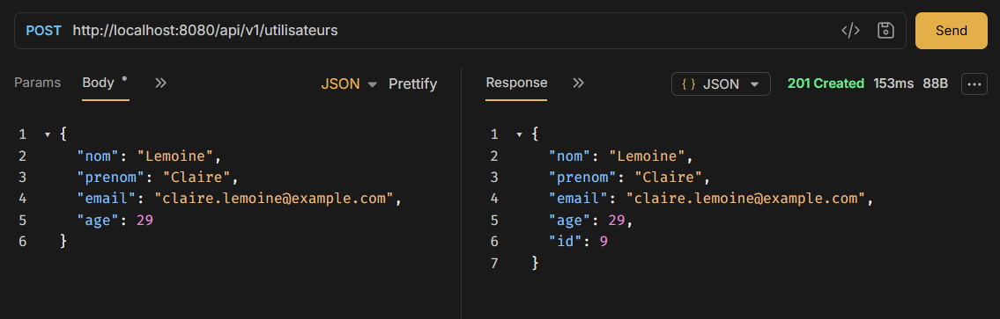

---

### 2.4 — PUT /api/v1/utilisateurs/1 (Modifier un utilisateur)

> **Description :** Mise à jour complète des informations de l'utilisateur n°1 (Jean-Paul Dupont).  
> **Résultat :** Code `200 OK` confirmant la modification en base de données.

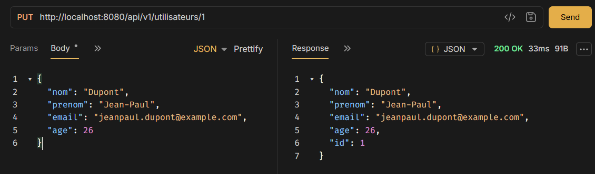

---

### 2.5 — DELETE /api/v1/utilisateurs/1 (Supprimer un utilisateur)

> **Description :** Suppression de l'utilisateur n°1 en base.  
> **Résultat :** Code `204 No Content` (succès sans contenu retourné).

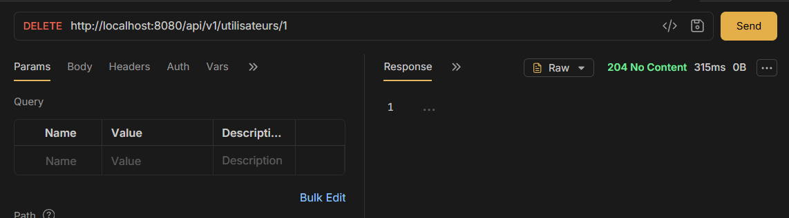

---

### 2.6 — POST /api/v1/utilisateurs (Gestion des erreurs de validation)

> **Description :** Test du gestionnaire d'exceptions global (`GlobalExceptionHandler`) avec un objet invalide (nom et prénom vides, email mal formé, âge négatif).  
> **Résultat :** Code `400 Bad Request` avec le détail précis de chaque contrainte non respectée.

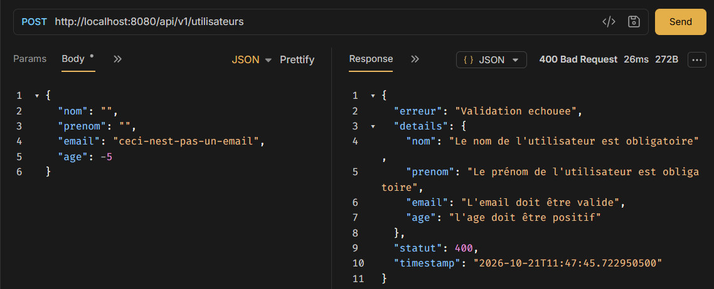

---

## Exercice 4 — Injection de dépendances et intercepteurs

### 4.1 — Retrait de @Primary (Erreur au démarrage de l'application)

> **Description :** Observation du conteneur Spring IoC après suppression de `@Primary` sur `ConsoleNotificationService`. Deux beans de type `NotificationService` sont trouvés sans possibilité de trancher.  
> **Résultat :** Échec du démarrage (`APPLICATION FAILED TO START`) avec l'exception `NoUniqueBeanDefinitionException`.

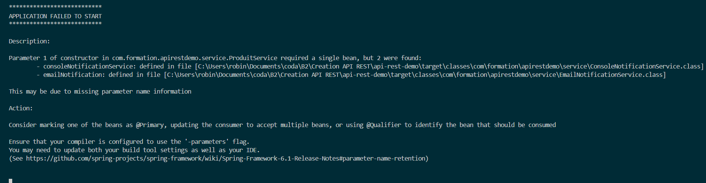

---

### 4.2 — DELETE /api/v1/produits/1 sans en-tête (Interception et refus)

> **Description :** Test de l'intercepteur `CleApiInterceptor` sur une requête `DELETE` sans l'en-tête `X-Api-Key`.  
> **Résultat :** Code `401 Unauthorized` et interruption du traitement (`preHandle` renvoie `false`).

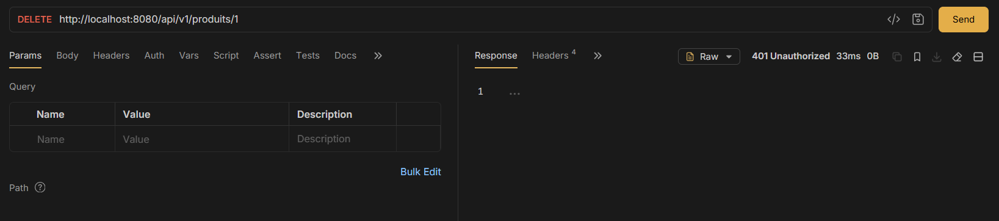

---

### 4.3 — DELETE /api/v1/produits/1 avec en-tête valide (Autorisation et exécution)

> **Description :** Test de l'intercepteur `CleApiInterceptor` avec l'en-tête `X-Api-Key: formation`.  
> **Résultat :** Code `204 No Content` confirmant le passage du filtre et la suppression du produit.

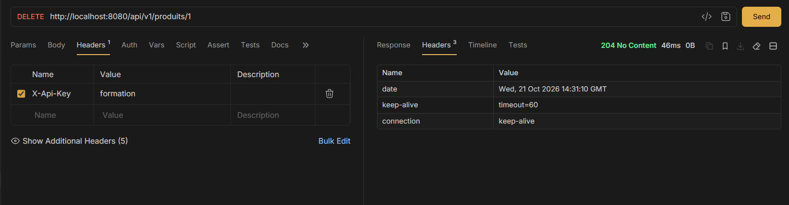
